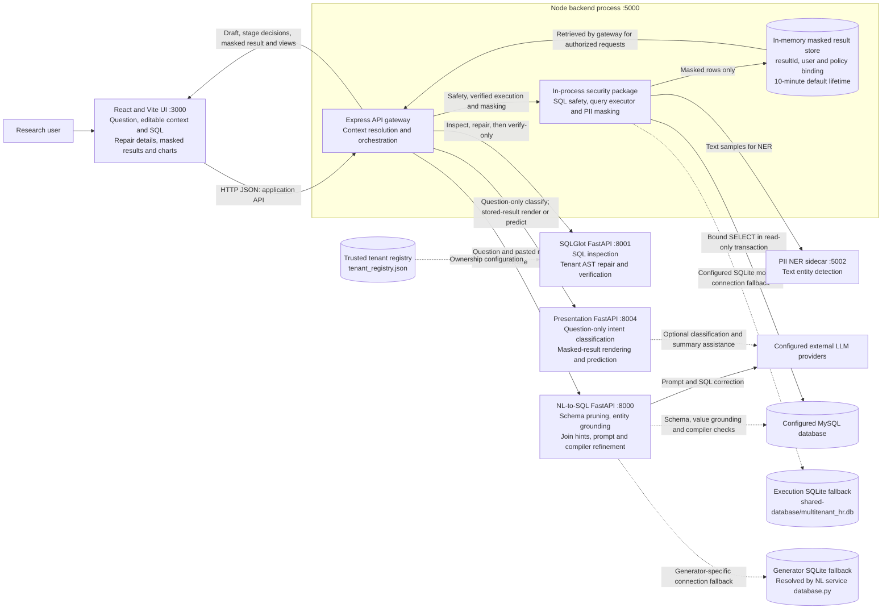
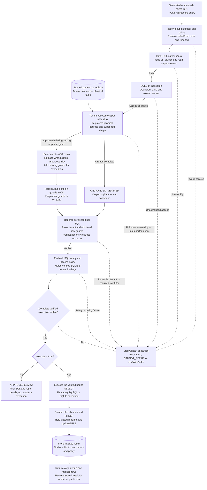

# Demo application architecture

Current implementation in demo-application, including deterministic tenant repair. Ports are development defaults. Solid arrows are primary calls or data flow; dashed arrows are optional, configuration, or database-grounding dependencies.

Open this document in a Mermaid-enabled Markdown viewer to display the diagrams. Editable sources: [service architecture](docs/diagrams/system-architecture.mmd), [tenant execution flow](docs/diagrams/tenant-execution-flow.mmd), and [canonical diagram specification](docs/diagrams/architecture.json).

The overview shows process and data dependencies. The second diagram expands the security path inside **Validate & execute**.
For data passed between individual components, see [the process-flow diagrams and input/output contracts](PROCESS_FLOW.md).

## Application services and data boundaries

<!-- mermaid:id=system_architecture -->

## Tenant isolation and secure execution pipeline

<!-- mermaid:id=tenant_execution_flow -->

## Implementation map

| Component | Default port | Source | Responsibility |
| --- | --- | --- | --- |
| React frontend | 3000 | [NlPipeline.jsx](frontend/src/pages/NlPipeline.jsx) | Intent classification, SQL review, tenant-stage details, masked results and visualizations |
| Express gateway | 5000 | [index.js](backend/src/index.js) | Resolve supplied context; coordinate generation, verification, execution and result access |
| Security package | In Node process | [security-middleware.js](packages/security-validation-layer/src/security-middleware.js), [query-executor.js](packages/security-validation-layer/src/query-executor.js), [secureQueryService.js](backend/src/services/secureQueryService.js) | AST safety checks, prepared read execution, PII classification and masking |
| NL-to-SQL service | 8000 | [main.py](nl-to-sql-service/main.py), [api.py](nl-to-sql-service/api.py) | Schema pruning, entity and relationship grounding, LLM generation and compiler refinement |
| SQLGlot service | 8001 | [app.py](sqlglot-service/app.py), [rewriter.py](sqlglot-service/rewriter.py), [registry](sqlglot-service/tenant_registry.json) | Inspect SQL, repair supported tenant defects and independently verify the final statement |
| PII NER service | 5002 | [ner_service.py](packages/security-validation-layer/pii_service/ner_service.py) | Detect person entities in result text before masking |
| Presentation service | 8004 | [api.py](presentation-service/api.py) | Question-only intent classification; render masked results; forecast and anomaly analysis |
| Temporary result store | In Node process | [resultStore.js](backend/src/services/resultStore.js) | Store masked results under a resultId bound to the supplied user, tenant and effective policy |

## Runtime behavior and boundaries

- **User workflow:** Generate SQL first classifies the question. Continue to SQL generates a draft without executing it. Validate & execute sends the current SQL and context through the security pipeline. The browser calls only the gateway.
- **Identity context:** The research UI accepts editable user and policy JSON. The gateway resolves policy values against those inputs; this demo does not authenticate the claimed identity.
- **Generation input:** The gateway sends `user_query` and pasted `injected_rules` to the NL service. Intent classification is kept separate from that request. Generation may read schema and distinct values and perform compiler checks using the NL service's database connection; that path precedes tenant repair of the generated application query.
- **Tenant enforcement:** Registered ownership is required for every referenced physical source and alias. An unused, unregistered table in a broader policy does not by itself block a query. Missing and wrong simple guards can be repaired; unsupported structures or failed checks stop application-query execution. Additional row restrictions must already be verifiable.
- **Verification and execution:** `/tenant-isolation` is first called with repair enabled, then with repair disabled on the serialized candidate. The gateway repeats SQL safety, access and binding checks. Only the resulting verified statement and server-derived tenant bindings reach the executor. `/api/verify-sql` is validation-only; `/api/secure-query` with `execute: false` produces a preview.
- **Database selection:** MySQL is the normal execution target. `DB_TYPE=sqlite` selects SQLite directly; the configured fallback can also use the bundled shared-database file after a MySQL connection failure. The generator resolves its own database and SQLite path independently.
- **PII boundary:** Raw rows remain in the execution and PII pipeline, and text samples can reach the NER sidecar. Only masked results enter the temporary result store, result presentation, prediction and the browser response. NER defaults to masking unverified text when detection is unavailable.
- **Post-execution requests:** `/api/present-result` and `/api/predict-result` retrieve the gateway's stored masked result after matching user and policy. The normal prediction path runs for a forecast request or anomaly intent. The older all-in-one presentation/prediction route is disabled by default; what-if simulation remains a separate optional endpoint.
- **Execution boundary:** The NL service's legacy `/api/v1/ask` rejects direct row execution. SQL application results must pass through the gateway.

The Mermaid sources and canonical JSON passed static validation. This is source-level validation, not evidence of acceptance by a particular Mermaid renderer. These documentation files do not change application behavior.
