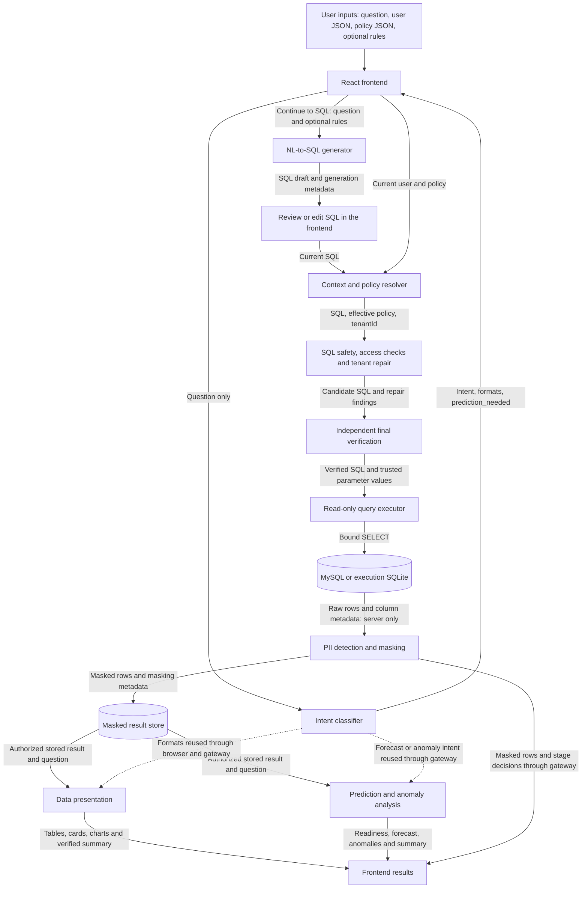
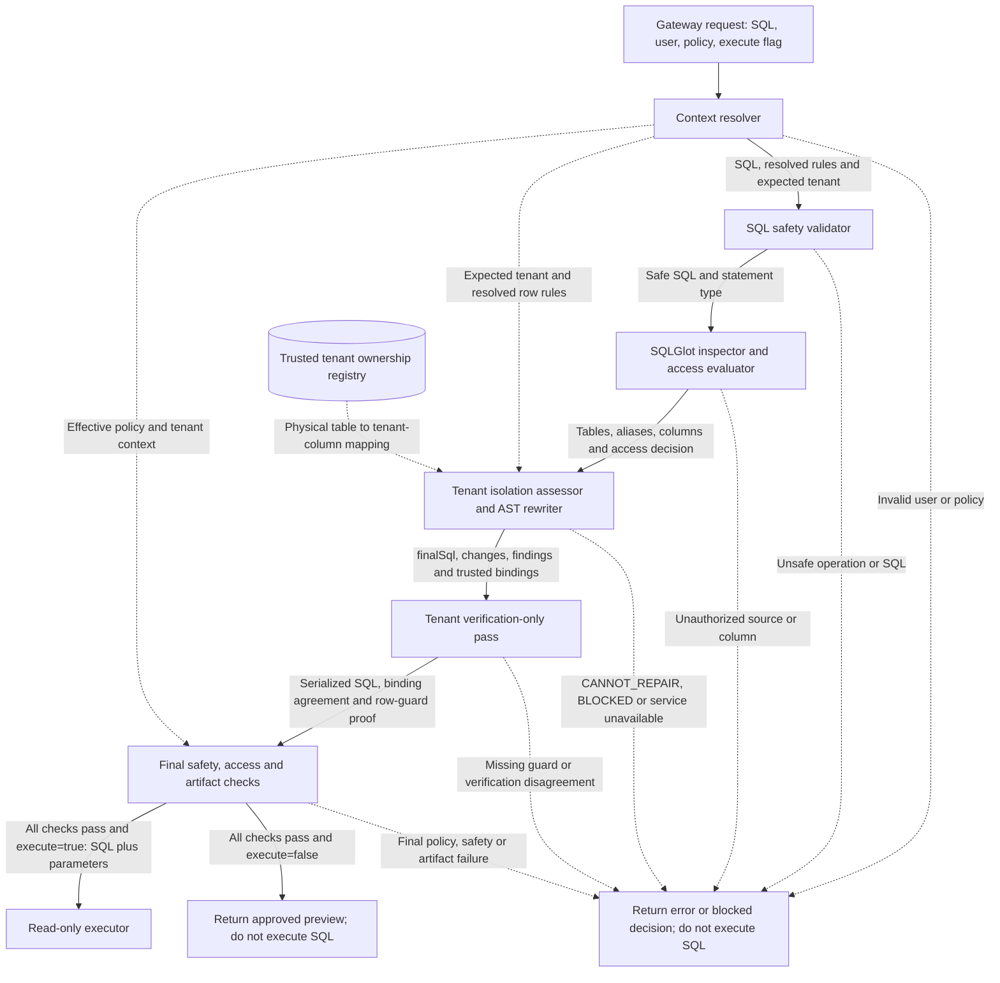
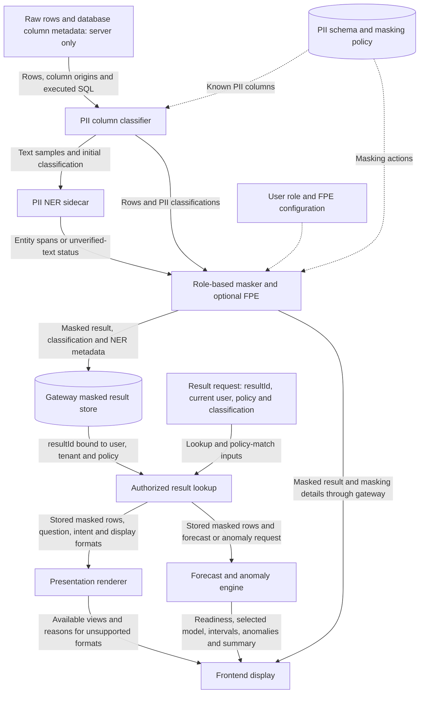
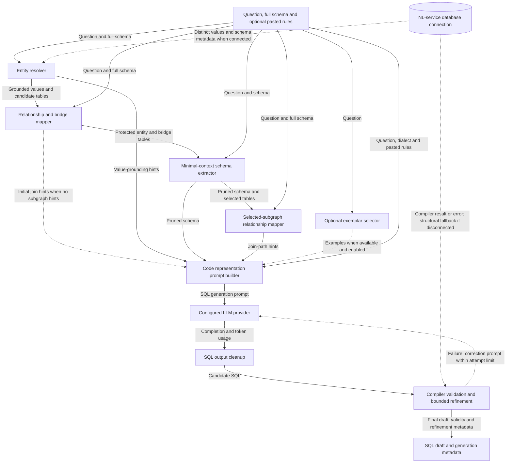

# Process flow, component inputs and outputs

Logical data flow of the existing demo application. Arrows name the data exchanged. Calls between browser, Python services and database execution are coordinated by the Node gateway; arrows between logical stages do not imply direct service-to-service HTTP calls.

Each arrow's label is the output of the source component and the input of its destination. Solid arrows show the normal flow; dotted arrows show configuration, optional processing, retries, or failure exits. Open this file in a Mermaid-enabled Markdown viewer to display the diagrams.

The current UI has three explicit actions: **Generate SQL** classifies the question, **Continue to SQL** generates a draft, and **Validate & execute** runs the reviewed SQL through security and execution. Classification metadata is retained for presentation and prediction; it is not included in the SQL-generation prompt.

## End-to-end component relationships

<!-- mermaid:id=process_overview -->

## Security and tenant-stage inputs and outputs

<!-- mermaid:id=security_component_io -->

## Result protection, presentation and prediction inputs and outputs

<!-- mermaid:id=result_component_io -->

## NL-to-SQL generation component inputs and outputs

<!-- mermaid:id=generator_component_io -->

## Component input/output contracts

| Component | Inputs | Outputs | Destination / relationship |
| --- | --- | --- | --- |
| React input and review UI | Question, editable user JSON, policy JSON, optional rules JSON, SQL edits | Separate classification, generation and secure-execution requests | Calls Node gateway; shows returned stage decisions and results |
| Intent classifier | `nl_query` only | `nl_query`, `intent`, `presentation_types`, `prediction_needed` | Returns to UI through gateway; metadata later accompanies result-rendering and prediction requests |
| Context resolver | User claims and policy row rules containing `valueFrom` | Effective policy with resolved values; expected `tenantId` | Supplies authorization and tenant stages; this is demo context resolution, not identity authentication |
| NL service schema loader | Selected database configuration or caller-supplied schema | Full schema and optional database connection | Supplies grounding, relationship discovery, pruning and compiler checks |
| Entity resolver | Question, schema, optional database values | Grounded values and candidate table names | Supplies prompt hints and protected tables |
| Relationship mapper | Candidate tables, question and full schema | Bridge tables and initial join-path hints | Protects necessary tables during pruning; supplies initial prompt guidance |
| Schema extractor | Question, full schema, protected tables | Pruned schema and pruning metadata | Supplies selected-subgraph mapping and prompt construction |
| Selected-subgraph mapper | Pruned table set, full schema and question | Join hints for selected sources | Supplies final join guidance to prompt builder |
| Optional exemplar selector | Question and available example dataset | Relevant example questions and SQL | Adds examples to prompt when available and enabled |
| Prompt builder and LLM | Question, dialect, pruned schema, pasted rules, grounding/join hints and optional examples | SQL completion and token metadata | SQL cleanup produces a candidate for compiler refinement |
| Compiler refinement | Candidate SQL, schema, original question and compiler feedback | Final SQL draft, validity flag, attempt count and refinement metadata; or generation error | Returns draft to gateway/UI; bounded model retries correct compiler problems, not tenant authorization |
| SQL safety validator | Current SQL, then final candidate and bound-query form | `safe`, statement type and violations | Allows inspection or blocks the query; runs again after repair |
| SQLGlot inspection and access evaluation | SQL, dialect, effective policy and canonical column allowlist | Tables, aliases, columns, filters, normalized SQL and access decisions | Supplies tenant analysis only when operation/table/column access is permitted |
| Tenant assessor and AST rewriter | SQL, dialect, expected tenant, resolved row rules and trusted ownership registry | Status, original/final SQL, findings, changes, parameterized SQL and trusted tenant bindings | Produces a supported candidate or returns `CANNOT_REPAIR`, `BLOCKED` or `UNAVAILABLE` |
| Independent tenant verification | Serialized final SQL and the same tenant/policy context; repair disabled | Verified mandatory guards, additional row-filter checks and matching bindings | Supplies final safety/access checks; failed verification prevents execution |
| Read-only executor | Exactly the verified parameterized SQL and server-derived bindings | Server-internal rows, column metadata, count, timing and truncation information; or execution error | Reads configured MySQL or execution SQLite; sends rows into the PII pipeline |
| PII classifier | Rows, source-column metadata, executed SQL and configured PII schema | Column PII types and detection methods | Supplies classifications and text samples to NER/masking |
| NER sidecar | Text samples and requested entity types | Entity spans or an unavailable/unverified-text outcome | Refines masking decisions; default closed mode masks text that could not be verified |
| Masker and optional FPE | Rows, classifications, entity spans, user role, masking policy and optional key | Masked rows, masking plan/counts, classification and NER metadata | Only this protected result can enter the result store, browser response and downstream analytics |
| Gateway result store | Masked result, question, user, tenant and effective policy | Temporary `resultId`; authorized retrieval or refusal | Rendering/prediction requests must match the stored user and policy; SQL-only requests without a question do not create a resultId |
| Presentation renderer | Retrieved masked result, original question, intent and recommended formats | `views` with type, availability, reason and table/card/chart/summary content | Returns display views through gateway to frontend |
| Forecast/anomaly engine | Retrieved masked result, question, intent and prediction flag | Readiness, strategy/model, forecast and intervals, anomalies, chart and verified summary; or refusal | Runs on forecast or anomaly requests; returns through gateway to frontend |

## API relationships

| Browser-to-gateway operation | Downstream component | Service payload / returned data |
| --- | --- | --- |
| `/api/classify-intent` | Presentation service `/api/v4/classify-intent` | Sends `nl_query`; receives intent, formats and prediction flag |
| `/api/generate-sql` | NL service `/api/v1/translate` | Gateway validates user/policy, but forwards only `user_query` and pasted `injected_rules`; receives `predicted_sql` and generation metadata |
| `/api/secure-query` | Safety/access checks, SQLGlot, executor and PII pipeline | Receives SQL, current user/policy, optional question and `execute`; returns decision, tenant repair report and, after successful execution, masked result |
| Secure-query inspection | SQLGlot `/inspect` | Sends SQL and dialect; receives AST-derived analysis |
| Secure-query tenant enforcement | SQLGlot `/tenant-isolation` | Sends SQL, dialect, tenant ID, resolved rules and `repair`; receives a `tenantRewrite` artifact. Called again with `repair: false` to verify |
| `/api/present-result` | Presentation service `/api/v4/render` | Browser supplies resultId/context/classification; gateway retrieves stored masked rows and forwards `member2_result`, question, intent and formats |
| `/api/predict-result` | Presentation service `/api/v4/predict` | Browser supplies resultId/context/classification; gateway forwards the stored masked result, question, intent and prediction flag |

The overview represents the normal interactive workflow. Optional legacy analysis/presentation and what-if routes are documented separately in [ARCHITECTURE.md](ARCHITECTURE.md). Direct row execution through the NL service is blocked. A tenant repair cannot authorize an otherwise forbidden table, column or SQL operation.

Editable Mermaid sources and the canonical specification are in [docs/diagrams](docs/diagrams). All four diagrams passed canonical JSON-schema and static Mermaid validation; no particular Mermaid renderer was invoked.
